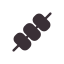
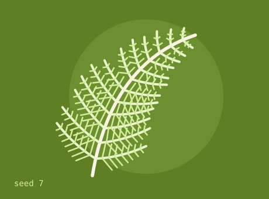

<!--
title: "Designing a logo system with a coding agent"
description: How we drew one set of logos for the Abang products by having a coding agent write SVG, render it, look at it and fix it, and where we would not trust the agent.
slug: logo-system-with-a-coding-agent
author: Jian
date: 2026-11-24
status: Published
tags: [behind-the-build, abang-ai]
product: abang-ai
sources:
  - abang-landing-page/AGENTS.md
  - abang-landing-page/index.html
  - abang-landing-page/design/brand/README.md
  - abang-landing-page/design/brand/variants.py
  - abang-landing-page/design/brand/fern.py
  - abang-landing-page/design/brand/svg/satay-icon.svg
  - abang-landing-page/design/brand/svg/satay-mono.svg
  - abang-landing-page/design/brand/svg/cuttlefish-crew-icon.svg
  - abang-landing-page/design/brand/svg/fraktal-scene.svg
  - abang-landing-page/assets/favicon.svg
  - abang-landing-page/blog/briefs/04-logo-system-with-a-coding-agent.md
-->

---

# Designing a logo system with a coding agent

A coding agent can write SVG (a text format for drawings), render it to an image, look at the result and fix it. That loop, and not any one prompt, is what gave us a logo set we are happy with. This post walks through how we built it for the Abang products, including the drawings that failed on first look.

## Where we started

The Abang landing page lists nine products. Early logo drafts came from image generators, and they looked like nine different studios had made them. Styles did not match, and none of them held up when shrunk to a browser tab.

Before drawing anything, we had the agent research what makes a logo set work. The advice was the same in most places: pick one shape language and a small palette, test the mark at 16 pixels, test it in one colour and on dark backgrounds, and treat the background as a variant of the logo, not part of it. We used that as our checklist.

## One construction for every product

We chose a single recipe. Each product gets a rounded-square tile in its own colour, a cream glyph (`#fbf4e4`) made of solid shapes, and at most one accent colour. There are no outlines, gradients or glow. For the larger illustrations, which we call scenes, a soft disc sits behind the subject and the tile colour is the ground.

We picked a tile for a plain reason. A tile gives every mark the same outer shape, so a set of different subjects (a coffee pot, a skewer, a fern) still reads as one family. The colour does the job of telling products apart.

Here is the satay mark. The whole thing is a skewer line and three rounded rectangles, rotated 45 degrees:


The set covers seven products (satay, sibei-flow, kopicode, kampong-agents, cuttlefish-crew, vikaki and fraktal) and the abang-ai ketupat, which is the umbrella mark. indah and semula kept the marks they already had.

## The loop: write, render, look, fix

The agent wrote the SVG, rendered it with Playwright (a tool that drives a real browser), and then looked at the picture. Looking mattered, because most of the faults were things you cannot see in the code. A path can be valid and still draw the wrong animal. Several marks failed on the first look:

- The capybara for sibei-flow read as a hamster.
- The cuttlefish read as a jellyfish. We fixed that, and it then read as a fish with a tail.
- The kopicode coffee pot read as a watering can.
- The tip of the satay skewer read as a pencil.
- Stripes on the cuttlefish made it look like a grub, so we removed them.

Each fix was small. We changed a proportion, removed a detail, or moved a shape. The cuttlefish ended up as a tall cream body with two fins, two closed eyes and a fan of eight short arms:


I think the main lesson is about where to put the human. We did not write long descriptions of what a cuttlefish should look like. We looked at each render, said what it resembled, and let the agent adjust. Naming the wrong animal ("this is a jellyfish") was more useful feedback than any instruction about shape.

Every new mark also has to pass the checks from the research. The README says to look at each one at 48, 32 and 16 pixels, in one colour, and on a dark ground, before it goes into the set.

## Variants, and why the background is not the logo

A logo ends up on surfaces we do not control: a GitHub avatar, a browser tab, an iPhone home screen. Each of those wants something different, so every product ships as a set of files in `design/brand/svg/`:

| File | Use |
|---|---|
| `<name>-icon.svg` | The main mark, a rounded tile. Product cards and docs headers. |
| `<name>-icon-square.svg` | A full-bleed square with no rounded corners, for avatars and app icons. |
| `<name>-mono.svg` | The glyph alone on a transparent background, in one colour. |
| `<name>-scene.svg` | The larger illustration for hero sections and t-shirts. |

The square exists because GitHub, Slack and iOS round the corners themselves. If you give them a pre-rounded tile, a pale fringe shows at the corners.

The mono file is the interesting one. In the satay version below, the tile colour and the dark parts become true holes (cut out with an SVG mask), and the rest is filled with `currentColor`. So it works on any background, and setting the CSS `color` recolours it.



We do not draw these by hand. `variants.py` reads each master tile icon and writes the square and mono files, so the three stay in sync, and we re-run it after any edit to a master. It needs two special cases. In sibei-flow the light water colour becomes a gap, so the waterline cuts into the capybara's head. In vikaki, the hat brim and nose become gaps, so the hat stays separate from the face.

The favicon follows the same idea. `assets/favicon.svg` is the bare ketupat on a transparent background, with a second colour for dark tabs. It is not the orange tile, because the bare glyph is larger and clearer at 16 pixels. The `apple-touch-icon.png` is the opposite, opaque and full-bleed, because iOS fills transparency with black.

## A logo drawn by a script

The fraktal scene is not drawn by hand at all. `fern.py` builds a fern frond from a seed: one curved spine, side branches that shrink towards the tip, and small leaflets on each branch. The same seed always gives the same frond, so the logo is a seed. The current scene uses seed 7, and the scene prints the seed in its corner.



To make a different one, you run:

```bash
python3 fern.py --seed 12 --frond-only --out frond.svg
```

This writes a transparent frond with no tile or disc. The script uses only the Python standard library, and its colours are constants at the top of the file. We like this for fraktal because the product is about generating structure from rules, and the logo now does the same.

## What we would not trust an agent with

These are hand-built SVGs, and they look it. They are flat shapes made from circles, rectangles and curves, and nobody has tuned the silhouettes the way a type designer or illustrator would. For print, we would trace or refine them in Inkscape or Figma first. The README says the same.

Three more limits are worth stating. The agent cannot tell us whether a mark is good. It can render and describe, but the judgement that a capybara looks like a hamster came from us, and for some marks it took several rounds. The set also has no wordmark lockups yet (the product name next to the mark), because the wordmark needs to be converted to outlines so that it renders without the font. And a set this consistent is partly a rule we imposed, flat shapes with no gradients, which suits small sizes and rules out richer styles.

If you want to reuse the approach, start with the rules (shape, palette, the 16-pixel and one-colour tests) and write them where the agent will read them. The README in `design/brand/` is our version of that, and the SVGs and both scripts sit next to it.
