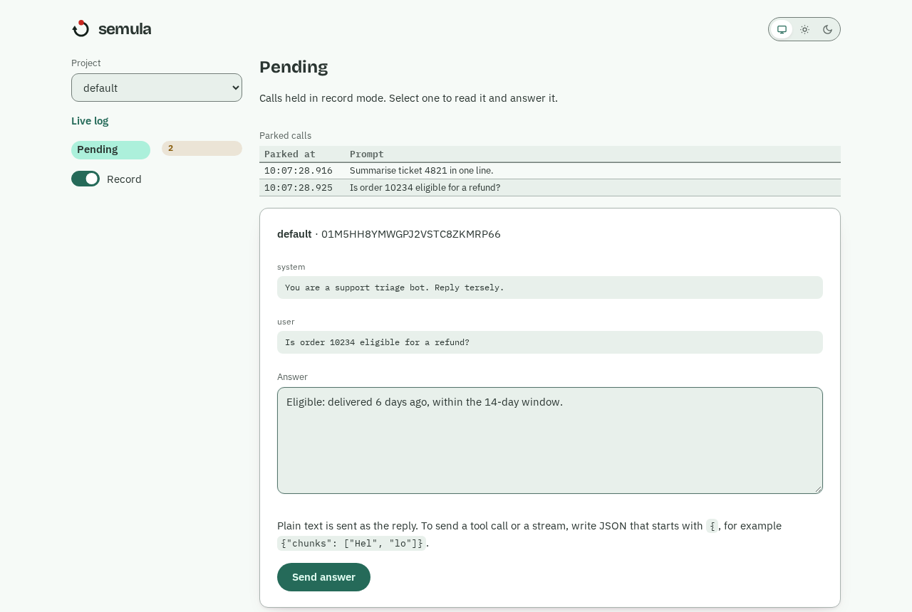

<!--
title: "Using an AI subscription as a mock LLM for tests"
description: semula lets a coding agent answer an app's OpenAI-compatible calls, then records those answers for repeatable offline tests. This post explains how recording, matching and streaming work.
slug: semula-subscription-as-mock-llm
author: Jian
date: 2026-11-07
status: Published
tags: [engineering, semula]
product: semula
sources:
  - abang-landing-page/index.html
  - semula/README.md
  - semula/CHANGELOG.md
  - semula/pyproject.toml
  - semula/docs/concepts.md
  - semula/docs/assets/dashboard-pending.png
  - semula/docs/guide/answerer.md
  - semula/docs/agents/PLAYBOOK.md
  - semula/docs/tutorial/first-recording.md
  - semula/docs/tutorial/dashboard.md
  - semula/docs/tutorial/near-misses.md
  - semula/docs/tutorial/replay.md
  - semula/docs/explanation/how-matching-works.md
  - semula/docs/adr/0002-record-mode-park-and-answer-queue.md
  - semula/docs/adr/0003-tiered-matching-safe-by-default.md
  - semula/docs/adr/0007-request-fingerprint-and-canonical-request.md
  - semula/docs/adr/0008-streaming-storage-and-replay.md
  - semula/docs/adr/0014-answerer-hook-runs-the-operators-command.md
  - semula/src/semula/api_openai.py
  - semula/src/semula/canonical.py
  - semula/src/semula/config.py
  - semula/src/semula/responses.py
  - semula/src/semula/streaming.py
-->

---

# Using an AI subscription as a mock LLM for tests

An LLM app can spend money just by running its test suite, and a hand-written mock often stops matching when the app's framework changes a prompt. I built semula to let a coding agent answer those calls through an OpenAI-compatible endpoint, then save each answer for later runs. The useful part is the recording. Replay gives the test the same answer without another model call, including when the agent is offline.

## A paid API is a poor default for every test run

Calling a real model is useful when we need to see how the real model behaves. It is a less useful default for tests that need a predictable answer in the right shape. Each call consumes API usage, the wording can change between runs, and a failure may tell us more about a model's latest answer than about the code under test.

Hand-written fixtures avoid those calls, but they have their own maintenance cost. If a framework adds a line to the system prompt or reorders a tool list, a fixture keyed to the full request can miss even though the application is asking the same question. Broadening the match carelessly is worse: an answer meant for one request can be returned for another, leaving a test green for the wrong reason.

semula sits at the app's OpenAI Chat Completions endpoint. We can use it while developing a feature and keep the resulting answers as test data. The coding agent writes the first answer through MCP or the CLI. Once it is stored, the agent is out of the replay path. I think that split is more useful than trying to make an agent answer every test call indefinitely.

## Record mode holds an unfamiliar call for an answer

The app points its OpenAI-compatible client at `http://127.0.0.1:8080/v1` and sends a request to `/v1/chat/completions`. This is the request in semula's README:

```bash
curl http://127.0.0.1:8080/v1/chat/completions \
  -H 'Content-Type: application/json' \
  -d '{"model": "gpt-4o", "messages": [{"role": "user", "content": "Name a fruit."}]}'
```

In `record` mode, an unknown request becomes a parked call. semula keeps the HTTP request open and puts the call in the pending list.



In this dashboard example, the refund question is selected and an answer is ready to send.

In a second terminal, the recording tutorial checks that list:

```bash
docker exec semula semula pending
```

```text
01M5HGVZ3RCV5X9QWZKTDG9D7Z	pending	default	Name a fruit.
```

The row gives the pending id, project and last message. The tutorial answers that id with `Mango`:

```bash
docker exec semula semula answer 01M5HGVZ3RCV5X9QWZKTDG9D7Z --text "Mango"
```

```text
answered 01M5HGVZ3RCV5X9QWZKTDG9D7Z -> entry 01M5HGZ4Y2JJHS5HCTKW5E12GT
```

semula validates the answer, saves an entry and releases the waiting HTTP call. The app receives a chat completion whose message is `Mango`. The tutorial sends the same request again:

```bash
curl -s http://127.0.0.1:8080/v1/chat/completions \
  -H 'Content-Type: application/json' \
  -d '{"model": "gpt-4o", "messages": [{"role": "user", "content": "Name a fruit."}]}'
```

It returns from the saved entry. The tutorial's call log shows both sides of the exchange:

```bash
docker exec semula semula log --limit 5
```

```text
10:02:07.793  default      hit            exact 1.00  3ms  01M5HGZ4Y2JJHS5HCTKW5E12GT  "Name a fruit."
10:02:07.703  default      recorded       -  104305ms  01M5HGVZ3RCV5X9QWZKTDG9D7Z  "Name a fruit."
```

The first call took as long as the answerer needed; the replay hit the exact tier in 3 ms. A coding agent can do the answering through the MCP tools `wait_for_pending`, `get_pending` and `answer_pending`, or through `semula pending`, `semula show` and `semula answer`. The agent playbook tells it to read the whole request, including the system message and offered tools, before answering.

There is a real timeout to account for. The default `record_timeout` is 300 seconds; if nobody answers before then, the app gets `semula_record_timeout`, while the call remains pending and a later answer is still saved. An app's own HTTP timeout must allow for the agent's response time. Record mode is therefore useful for gathering answers during development, but I would not put it in a fast, unattended test run unless an answerer is already running.

## A fingerprint makes the recording reusable

The saved answer becomes reusable because semula fingerprints a canonical request, rather than the raw HTTP body. It sorts tools by name, then makes an exact key and a normalised key that ignores spacing, timestamps, UUIDs and absolute paths. A fresh timestamp can therefore find the same entry. A project can add scrub rules or limit matching to the last few messages.

The example's model name is not part of the key. By default, `model`, `temperature`, `top_p`, `max_tokens`, `stream`, `user` and `seed` are ignored. A project can count a parameter with `include_params` when it changes the right answer.

Scrubbing can merge requests that should remain separate, so I would inspect misses with `semula test-match` before adding a rule. Stored requests have built-in credential redaction and can have project-specific patterns, but recorded answers are not redacted. An agent should not put secrets in an answer.

## Near matches wait for review

A replay should fail when semula is unsure. The tiers make that choice visible:

| Tier | What it matches | Default action |
|---|---|---|
| Exact | Same messages and tools | Serve |
| Normalised | Differences removed by normalisation | Serve |
| Alias | A pairing a person approved | Serve |
| Words | Word overlap, with the same roles, tools and included parameters | Serve at score `1`; send candidates from `0.6` to review |
| Meaning | Paraphrases found by optional embeddings | Disabled unless installed and enabled; send candidates from `0.75` to review, never serve without a project opt-in |

That strict word threshold costs some hit rate, but it avoids a plausible answer for the wrong prompt. A near match still counts as a miss: it parks in record mode or fails in replay mode, while the candidate goes to the review queue. A reviewer compares both requests and the stored answer, then approves an alias or rejects the pairing. Approval changes later calls; a call already parked still needs an answer. I would keep the serve threshold strict until those reviews show which variations are safe for the app.

## One entry can answer streamed and ordinary calls

Many clients request `stream: true`, while an agent usually writes a complete answer. semula stores the assembled assistant message, finish reason and usage. If an answer arrived as a stream, it also keeps its chunk boundaries. A later streamed call replays those chunks; if the entry has only a complete message, semula splits it into chunks (24 characters by default). The stream finishes with `data: [DONE]`, as an OpenAI-style stream does.

The reverse works too: a non-stream request can use an entry captured from a stream. Since `stream` is ignored by the default fingerprint, one recorded answer can serve both forms. That is convenient for tests that exercise the same app flow through different clients, but it is not a model of real token timing. Re-chunked boundaries differ from a provider's, and replay is immediate by default. An app that depends on the exact timing or boundaries of live generation needs a real-provider test as well.

## Try one recording, then switch to replay

The README starts a local container in record mode with a named volume:

```bash
docker run -d --name semula -p 127.0.0.1:8080:8080 \
  -e SEMULA_MODE=record -v semula-data:/data ghcr.io/leejianrong/semula
```

Send the `Name a fruit.` request above, answer its pending id, and send it again to use the stored entry; when the entries cover the test, switch the default project with `docker exec semula semula mode replay --project default`. The [semula documentation](https://semula.abangai.dev/docs/) has the recording tutorial and the matching guide for the next step.
